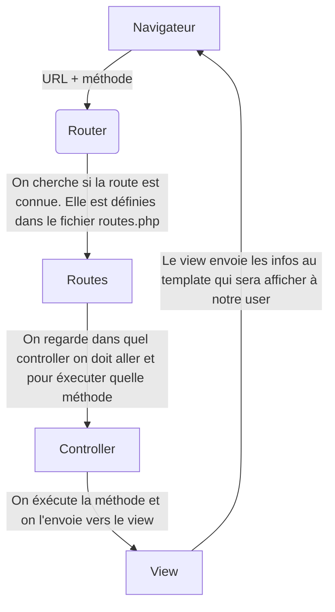

# Architecture

## 1 - Le cycle de vie d'une requête

## 2- Le rôle de chaque classe
| Classe | Rôle |
|:-------- |:--------:|
| Application     | Cette classe est le coeur de l'application, elle orchestre le conteneur et le routeur |
| Container    |  Le container permet de créer, réccupérer un serivce.  |
| Request    | Les superglobales PHP sont rangés ici pour ne pas les manipuler directement   |
| Router     | Le router regarde si une route existe ou non, et guide vers le controller|
| View    | C'est la classe qui sert de moteur de vues, elle prépare les données qui seront afficher dans les différents templates   |
| ContactController   | C'est la classe qui enregistre toutes les méthodes pour la création, modification , suppresion d'un contact   |
| HomeController  | C'est la classe qui enregistre les méthodes pour afficher l'annuaire  |

## 3 - L'injection de dépendance et la réduction de couplage
Mon container.php gère l'injection de dépendances. Les fonctions définies au sein de ce fichiers sont utilisés dans les autres fichiers de mon framework. Si demain je change de framework, je n'ai juste qu'à modifier le conainter sans ne toucher à rien d'autre. Sachant que le couplage s'explique pndance d'une classe à une autre, ici le coupable est très faible.         

## 4 - Les limites de mon app et les améliorations 
- Mon app ne possède pas de BDD et hébèrge les données via un json
- On pourrait envoyer un mail directement dans l'app
- Créer un sytème de connexion pour que chaque personne ait un accès distinct sans pouvoir lire les infos des autres
- 